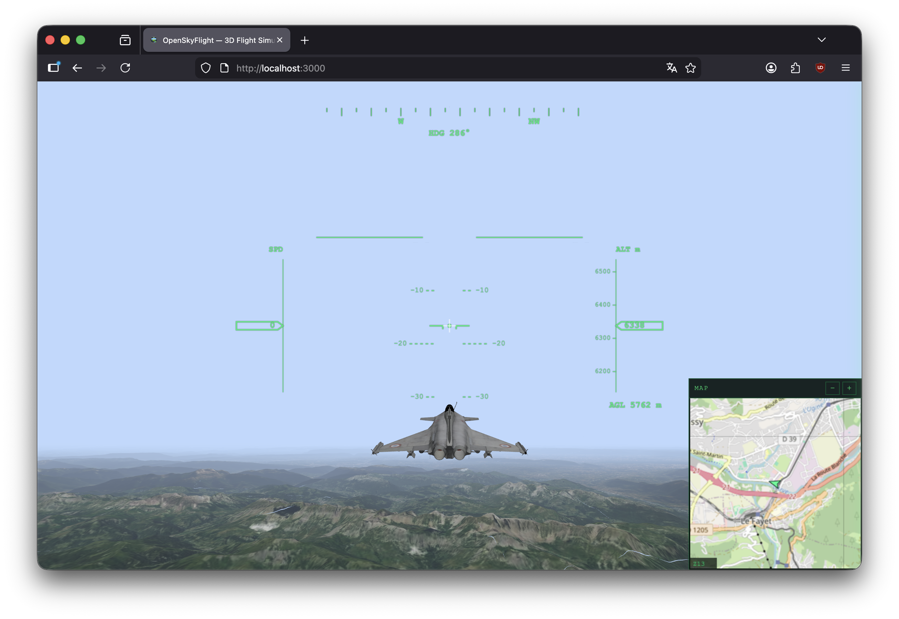
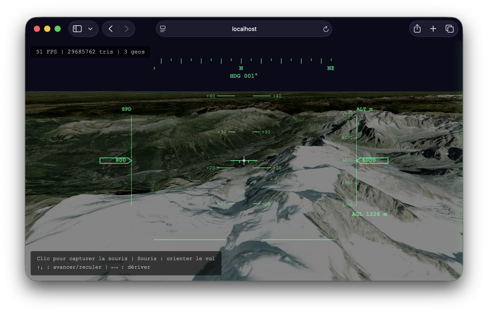
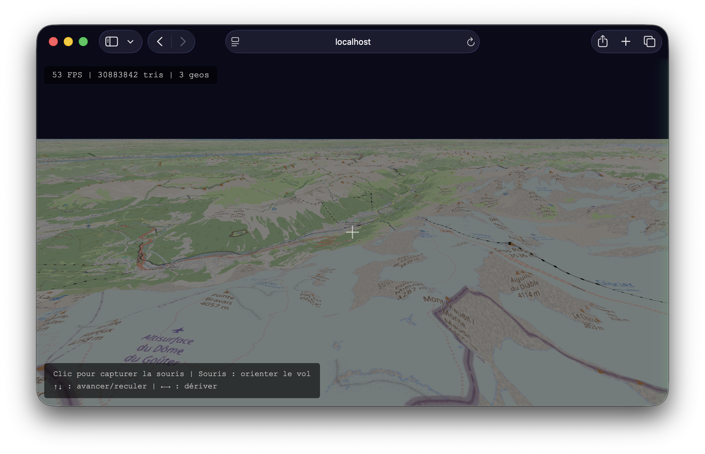
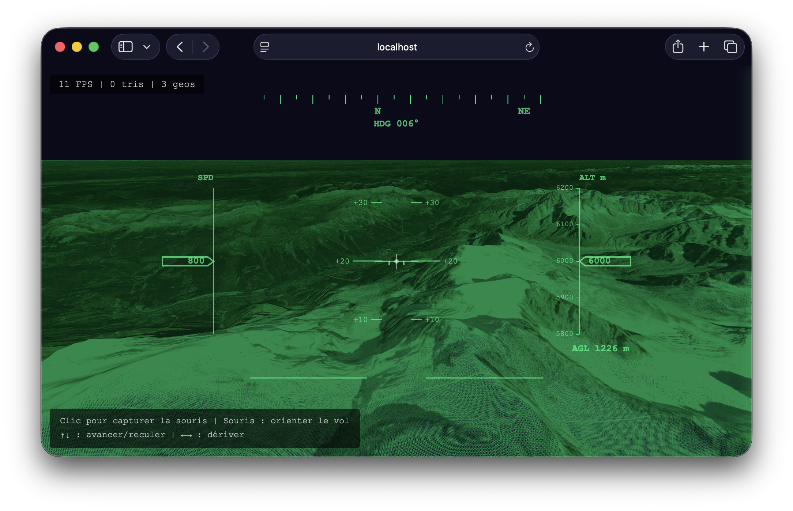
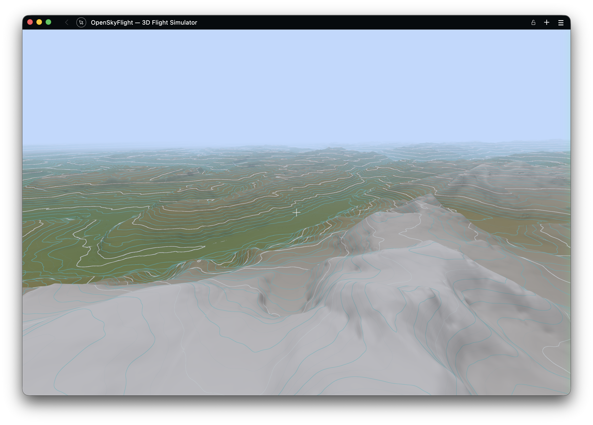

# OpenSkyFlight

A browser-based 3D flight simulator over real-world terrain. Fly anywhere on Earth using elevation data from AWS Terrarium and multiple texture modes (satellite, road map, SAR radar, elevation contours) — all rendered in real time with Three.js WebGPU. No API key, and a single one-time build of the vendored terrain engine.


[](https://www.youtube.com/watch?v=WBhs0ORsLuw)

[](https://www.youtube.com/watch?v=WBhs0ORsLuw)

<!-- Hero screenshot: full-screen flight over mountains with HUD, satellite textures, and minimap visible -->


## Features

- **Real-world elevation** — [AWS Terrarium](https://registry.opendata.aws/terrain-tiles/) PNG tiles decoded into float height textures and displaced on the GPU via TSL `positionNode`, in a metric world (1 unit = 1 m) that keeps slopes at their true steepness
- **4 texture modes** — Satellite imagery, Road map, SAR radar, and Elevation contour lines — cycle with `T` or pick from the settings menu
- **Hi-Res mode (zoom 18)** — press `R` to toggle upsampled elevation with zoom-18 satellite textures for sharper close-up detail. Hi-res tiles are concentrated at the view center and fade concentrically toward the periphery. Best suited for static or slow-moving views; fast flight may cause temporary pixelation while high-zoom tiles load
- **Adaptive LOD** — quadtree subdivision based on camera distance, with concentric view-center weighting for hi-res zoom levels; tiles join seamlessly and morph between levels of detail, relief and imagery, instead of popping
- **Rafale aircraft** — 3D GLTF model in the Armée de l'Air livery (panel lines, rivets and markings taken from DCS livery sheets and projected onto the model over a plain paint, with a relief map drawn from the lines), with retracted landing gear, canards, elevons, rudder and slats moved by the flight control system, chase camera (30 m behind)
- **Flight model** — the Rafale flies by its weight, wings and engines: six degrees of freedom, lift and drag with angle of attack and Mach, two M88-2 engines (2 × 50 kN dry, 2 × 75 kN with afterburner) whose thrust follows altitude and speed, fuel burn, standard atmosphere; a fly-by-wire control system holds the flight path at neutral stick and limits the aircraft to +9 / −3.2 g and 29° of angle of attack, rolling at up to 270°/s. Its performance is checked against the published figures by `npm run flight:bench` (turn rates, top speed at sea level and at 11 000 m, ceiling, approach speed). The previous free flight remains as the Exploration mode (`F`)
- **Cockpit / chase toggle** — press `V` to switch between first-person cockpit (roll applied to horizon) and third-person chase view
- **Flight controls** — mouse aim (the mouse moves an aim circle and an instructor flies the nose to it within the aircraft's limits), keyboard stick and rudder, throttle with a detent before the afterburner, airbrake, landing gear, gamepad (standard layout); simulated at a fixed 240 Hz step whatever the frame rate
- **Aircraft-style HUD** — compass, artificial horizon, altimeter (MSL + AGL), speed indicator; in the Simulation mode indicated airspeed, Mach, load factor, angle of attack, throttle, fuel, flight path marker, nose cross and aim circle
- **Settings menu** — `Esc` pauses the flight and opens a game-style menu (Graphics, World, Flight, Controls) over the live scene, driven by mouse or keyboard (`↑` `↓` select, `←` `→` change, `Q` / `E` switch tab, `R` restore the default), with the performance impact and visual gain of each graphics setting, synthesised interface sounds and an Audio tab (master, interface, engine and radio volumes); a quality preset (Low / Medium / High / Ultra) sets the graphics settings at once, settings are remembered across sessions and can be given in the URL (`?quality=low&showClouds=true`); `?dev=1` adds a Developer tab (live GPU figures, reference views, benchmark, raw rendering values)
- **OSM minimap** — real-time 2D map overlay with airplane marker and independent zoom
- **Flight plan system** — record waypoints, save/load flight plans, and engage autopilot to follow a path automatically
- **Local tile cache** — transparent caching proxy, pre-download tiles for offline flight
- **Physical atmosphere** — precomputed atmospheric scattering ([takram](https://github.com/takram-design-engineering/three-geospatial)): sky, aerial perspective read from a frustum-aligned volume, sunlight and sky light evaluated at each surface point, all from the same scattering tables; the terrain follows the curvature of the Earth and meets the horizon of the sphere, with the distant ground beyond the tiles drawn by the sky; a Visibility setting sets the haze
- **Volumetric clouds** — cumulus, mid-level clouds and fibrous cirrus ray-marched in real time (after [takram's three-clouds](https://github.com/takram-design-engineering/three-geospatial)) that you can fly through, with their shadows on the ground and on the aircraft, light shafts in the haze, and settings for their cover and altitude (WebGPU)
- **Shadows** — the relief casts its shadows across the valleys and onto the aircraft, from maps of the terrain marched toward the sun or the moon (edges softened by the size of the sun's disc), and the aircraft casts its own on itself and on the ground (WebGPU; a Shadows setting)
- **Time of day** — the sun follows the date and the local solar time (NOAA formulas), with time frozen, real time or accelerated up to ×600
- **Night** — stars turning with the hour, the moon with its phases and moonlight, an exposure that follows the falling light, night vision that fades colors into a bluish grey, and city lights from NASA's Black Marble imagery, to which the exposure adapts when a town fills the view
- **Aircraft lights** — position lights, flashing red beacons and white wingtip strobes (switched with `O`) with their glare, engine glow with thrust and an afterburner flame with shock diamonds
- **HDR render pipeline** — scene rendered into a HalfFloat buffer with a 32-bit reversed depth buffer, temporal anti-aliasing with upscaling (TAAU), bloom limited to the sun and its specular reflections, automatic exposure metered on the GPU, AgX tone mapping at the end of the pipeline
- **Dynamic resolution** — the 3D scene is rendered below the screen resolution when the GPU exceeds a 60 FPS budget, and TAAU reconstructs the full-resolution image
- **Built-in benchmark** — automated camera path with FPS/GPU timing (GPU span of each frame), metrics recording, and baseline comparison
- **Toast notifications** — non-blocking user feedback for search results and errors
- **Centralized logging** — in-app log panel with level control (DEBUG/INFO/WARN/ERROR)

<!-- Screenshot: chase camera view following the Rafale -->


*Third-person chase camera following the Rafale over satellite-textured terrain.*

## Quick Start

1. Build the vendored terrain engine once (**required** — the bundle is not versioned, see [Building three-tile](#building-three-tile-required)):

   ```bash
   cd vendor/three-tile
   npm install
   npm run build:lib
   cd ../..
   ```

2. Start the dev server (no other dependency needed to run the app):

   ```bash
   node scripts/serve.js
   ```

Then open [http://localhost:3000](http://localhost:3000) in your browser.

The server acts as a **caching proxy** for map tiles — every tile downloaded from the internet is automatically saved to `cache/` on disk, so it's never fetched twice.

### Development tools (optional)

Install dev dependencies for linting and formatting:

```bash
npm install
```

Available scripts:

| Command | Description |
|---|---|
| `npm run dev` | Start the dev server |
| `npm run lint` | Run ESLint |
| `npm run lint:fix` | Run ESLint with auto-fix |
| `npm test` | Run the unit tests (Node test runner), including the flight model checks |
| `npm run flight:bench` | Measure the flight model against the published figures of the Rafale |
| `npm run flight:scenario -- --out <dir> [--airport LSGG] [--runway 0] [--end 0] [--time-scale 3]` | Fly a circuit from a real runway in Chrome with the scripted pilot (takeoff, circuit, guided final, landing) and save its report and a screenshot per phase (needs the dev server) |
| `npm run livery:build` | Redraw the livery sheets of `assets/models/rafale/ada/source` (plain paint, their panel lines, rivets and markings), project them onto the Rafale model and write `assets/models/rafale/ada/Rafale.gltf` with its colour and normal atlases |
| `npm run format` | Format all files with Prettier |
| `npm run format:check` | Check formatting without modifying files |
| `npm run render:capture -- --out <dir>` | Screenshot every reference view in Chrome and measure frame pacing, draw calls and GPU cost (dev server must be running); `--views 1,6` selects views, `--set key=value` overrides a setting |
| `npm run render:benchmark -- --out <dir> [--plan <n>]` | Run the in-app benchmark in Chrome and save its JSON report; `--set key=value` passes a setting, e.g. `--set quality=low` |
| `npm run render:summary -- <report.json>...` | Print comparable figures (FPS, p5/p1, GPU, slow frames) for benchmark reports |

### Controls

| Input | Action |
|---|---|
| Click the viewport | Lock the mouse pointer |
| Mouse | Aim: the aircraft turns towards the circle (Exploration: look around) |
| `↑` / `↓` | Push / pull the stick (Exploration: move forward / backward) |
| `A` / `D` or `←` / `→` | Roll left / right (`Q` / `D` on AZERTY; Exploration: strafe) |
| `Q` / `E` | Rudder left / right (`A` / `E` on AZERTY) |
| `W` / `S` | Throttle up / down; release and press `W` again at full power for the afterburner (`Z` / `S` on AZERTY; Exploration: move forward / backward) |
| `Space` | Airbrake (hold); on the ground, also the wheel brakes |
| `G` | Landing gear down / up (Simulation flight; locked down while the wheels carry the aircraft) |
| `C` | Autopilot: hold the heading and altitude (any stick or aim input disconnects it) |
| `Enter` / `Space` | After a crash: restart in flight / on the ground where the flight started |
| `F` | Simulation or Exploration (free flight) mode |
| `T` | Cycle texture mode (Satellite / Road map / SAR / Elevation) |
| `V` | Toggle cockpit / chase view |
| `O` | Toggle anti-collision lights (beacons and strobes) |
| `H` | Toggle HUD |
| `M` | Toggle minimap |
| `I` | Toggle performance figures |
| `R` | Toggle Hi-Res mode (zoom 18) — best for static views |
| `X` | Toggle debug tile overlay (developer mode) |
| `B` | Start / stop benchmark (developer mode) |
| `Shift+B` | Store last benchmark as baseline (developer mode) |
| `K` | Cycle reference views (developer mode; also `?view=<n>` in the URL) |
| `N` | Start / stop flight plan recording |
| `Shift+N` | Clear current flight plan |
| `P` | Add waypoint (while recording) |
| `L` | Open / close flight plan menu |
| `U` | Engage / disengage autopilot |
| `1`–`9` | Select flight plan from menu |
| `Esc` | Pause and open the settings menu / resume / close the flight plan menu |

> **Developer mode:** open the app with `?dev=1` (remembered until `?dev=0`) to enable the developer shortcuts and the Developer tab of the settings menu.

> **Keyboard layouts:** Flight controls (WASD) use physical key positions, so they map to ZQSD on AZERTY keyboards. All other shortcuts use the character printed on the key and work identically on any layout.

> **Gamepad:** a gamepad in the standard layout (Xbox, PlayStation) flies without clicking the view: left stick for pitch and roll (pull back to raise the nose, invertible in the Flight tab), triggers for the throttle, right stick or bumpers for the rudder, `B` for the airbrake, `X` for the landing gear, `Y` for the chase or cockpit view and the menu button to pause or resume; in the Exploration mode the left stick steers, the triggers move forward and backward and the right stick slides sideways. Its sensitivity is set in the Flight tab. Flown with the keys or the gamepad, the chase view follows the airframe, roll included; with the mouse it looks along the aim.

The settings menu (`Esc`) also lists every shortcut in its Controls tab.

## Building three-tile (required)

The terrain engine relies on [three-tile](https://github.com/sxguojf/three-tile), a lightweight Three.js tile map library. We vendor a patched fork (`0.11.8-osf`) in `vendor/three-tile/` with custom LOD enhancements (concentric view-center weighting, removal hysteresis), WebGPU tile materials, Terrarium elevation decoded in a worker into float height textures with seamless tile edges, and anisotropic filtering of tile imagery.

The app imports the built bundle `vendor/three-tile/packages/lib/dist/three-tile-osf.js` via the import map. This file is **not versioned** (`dist/` is git-ignored), so it must be built after cloning, and again after any change to `vendor/three-tile/packages/lib/src/`:

```bash
cd vendor/three-tile
npm install        # first time only
npm run build:lib
```

Without this bundle the import map cannot resolve `three-tile` and the app does not start.

## Real-World Mode

Search a place name or enter coordinates in the World tab of the settings menu, then click **Fly there**. The app fetches elevation data from AWS Terrarium and overlays one of four texture modes, switchable at runtime with `T` or the settings menu.

Default location: **Mont Blanc** (45.8326°N, 6.8652°E).

To take off from an airport, search it by code (`LFPG`), name or town under **Airports** in the World tab and pick a runway end: the terrain loads around it and the aircraft stands lined up on the runway, engines at idle. Paved runways are drawn with their ICAO markings, the ground under them is flattened, the imagery around them goes down to zoom 18, and lit runways switch on their edge, centre line, threshold and approach lights and their PAPI at dusk or in low visibility. Airports and runways come from [OurAirports](https://ourairports.com/data/) (public domain): the dev server downloads the data once into `cache/ourairports/` and serves a search (`/api/airports?q=…`) and the runways of a map tile (`/api/runways/{z}/{x}/{y}`), which the app loads around the aircraft. Restart `npm run dev` after updating so the server has these routes.

<!-- Texture modes 2×2 grid — capture each mode at the same camera position over Mont Blanc -->
| Satellite | Road map |
|---|---|
|  |  |
| **SAR radar** | **Elevation lines** |
|  |  |

*Top-left: ESRI satellite imagery. Top-right: OpenStreetMap road map. Bottom-left: SAR radar style (black sky, side-looking light, grey speckle grain). Bottom-right: elevation contour lines (cyan lines on dark background).*

## How It Works

1. **Elevation** — Terrarium PNG tiles (AWS S3) are decoded in a worker (`R×256 + G + B/256 − 32768` metres), sampled at the tile grid vertices across tile boundaries into a float texture, and displaced on the GPU by a TSL `positionNode` shader. Neighbouring tiles share their edges exactly, and the edges of a tile beside a coarser one follow the coarser edge, so the terrain has no steps between tiles. The tile map is scaled horizontally by cos(latitude) so that world units are metres on all three axes
2. **LOD system** — three-tile's quadtree subdivision splits tiles near the camera into 4 children at higher zoom; a concentric weighting concentrates hi-res tiles (zoom 16–18) at the view center while distant and peripheral tiles stay coarse
3. **Textures** — Four modes: Satellite (ESRI) and Road map (OSM) fetch raster tiles on demand; SAR radar and the contour map (glowing contour lines over dark ground) are GPU-generated via TSL shaders
4. **Caching** — A Node.js proxy intercepts all `/tiles/` requests: serves from disk on hit, fetches upstream on miss, caches for next time

## Tile Cache

The dev server (`scripts/serve.js`) acts as a transparent caching proxy. When the browser requests a tile:

1. **Cache hit** — the file exists in `cache/`, served instantly from disk (`X-Cache: HIT`)
2. **Cache miss** — fetched from the remote server, saved to `cache/`, then returned (`X-Cache: MISS`)

Every tile is downloaded **at most once**. Subsequent sessions, or navigating back to a previously visited area, will always load from the local cache.

```
cache/
  terrarium/        ← elevation tiles (AWS Terrarium)
  osm/              ← map textures (OpenStreetMap)
  satellite/        ← satellite imagery (ESRI)
  nightlights/      ← city lights at night (NASA Black Marble, GIBS)
  ourairports/      ← airports and runways (OurAirports CSV files)
```

> The `cache/` directory is listed in `.gitignore` and should not be committed — it can be regenerated at any time.


## Project Structure

```
├── index.html                 Entry point (UI structure, import map)
├── css/main.css               Stylesheet (CSS custom properties)
├── js/
│   ├── app.js                 Orchestrator: init, input bindings, render loop
│   ├── aircraft/              Rafale GLTF model loading & animation, control surfaces, aircraft lights & engine glow, its shadow
│   ├── atmosphere/            Atmospheric scattering, aerial perspective volume, sun & moon ephemerides, night exposure
│   ├── clouds/                Volumetric clouds (noise textures, ray march, temporal upscaling), their shadows, light shafts and light on the aircraft
│   ├── benchmark/             Automated perf testing & baseline comparison
│   ├── camera/                Chase camera, springs
│   ├── constants/             Shared constants (camera, HUD, physics, terrain…)
│   ├── flight/                Aircraft state, flight model (aerodynamics, engines, fly-by-wire), mouse aim, Simulation and Exploration modes, verification bench
│   ├── flightplan/            Waypoint recording, flight plan interpolation, autopilot
│   ├── geo/                   Tile math, elevation provider, fetch limiter
│   ├── input/                 Keyboard dispatch (e.code for flight, e.key for actions), flight controls from keyboard, mouse and gamepad
│   ├── rendering/             Render pipeline (HDR scene pass, TAAU, glow pass, bloom, night vision, tone mapping), dynamic resolution
│   ├── sim/                   Fixed-step simulation clock, standard atmosphere, entity registry
│   ├── scene/                 Renderer, scene, camera & lights factory
│   ├── terrain/               Real-world terrain manager (three-tile integration), shadows of the relief, contour map, city lights
│   ├── ui/                    HUD instruments, flight plan menu, minimap, settings menu
│   └── utils/                 Reactive config, settings schema, quality presets, stored settings, logger
├── assets/
│   ├── models/                3D models: Rafale GLTF source and its Armée de l'Air build (rafale/ada)
│   └── flightplans/           Saved flight plan JSON files
├── tests/                     Unit tests of the simulation modules
├── scripts/
│   ├── serve.js               Dev server with caching tile proxy
│   ├── rafale-livery.js       Rafale livery build: sheets registered on the model, atlas, normal map (helpers in livery/)
│   ├── airports.js            Airport search and runways by tile, from OurAirports
│   ├── prefetch-tiles.js      Bulk tile downloader for offline use
│   ├── render-capture.js      Reference view screenshots & frame timing (Chrome)
│   ├── render-benchmark.js    In-app flight benchmark runner (Chrome)
│   └── render-summary.js      Comparable figures from benchmark reports
├── vendor/three-tile/         Vendored three-tile (0.11.8-osf) with concentric LOD
├── vendor/takram/             Vendored takram atmosphere WebGPU builds, with local patches (see its README)
├── docs/
│   ├── rendering-roadmap.md   Rendering overhaul plan, progress, measurements, decisions
│   ├── gameplay-roadmap.md    Flight model, takeoff and landing, radar, weapons and drones plan, progress, decisions
│   └── screenshots/           README screenshots, reference view captures per milestone
├── benchmarks/                Benchmark reports and full-resolution captures (git-ignored)
└── cache/                     Local tile cache (git-ignored)
```

## Technologies

- [Three.js](https://threejs.org/) v0.187 (WebGPU build) — 3D rendering with TSL shaders (loaded via CDN, no install)
- [three-tile](https://github.com/sxguojf/three-tile) (0.11.8-osf) — geographic tile management with patched concentric LOD
- Canvas 2D — HUD instrument overlay, hi-res badge, and minimap
- [@takram/three-atmosphere](https://github.com/takram-design-engineering/three-geospatial) (WebGPU build, vendored in `vendor/takram/`) — precomputed atmospheric scattering: sky, aerial perspective, sunlight and moonlight, stars
- [AWS Terrarium Tiles](https://registry.opendata.aws/terrain-tiles/) — elevation data (zoom 0–15, upsampled to 18 in hi-res mode)
- [OpenStreetMap](https://www.openstreetmap.org/) — road map textures
- [ESRI World Imagery](https://www.arcgis.com/home/item.html?id=10df2279f9684e4a9f6a7f08febac2a9) — satellite imagery (up to zoom 18+)
- [NASA Black Marble](https://earthobservatory.nasa.gov/features/NightLights) (VIIRS, 2016, via NASA GIBS) — city lights at night (zoom 0–8)
- [OurAirports](https://ourairports.com/data/) (public domain) — airports and runways
- Node.js — dev server with transparent caching tile proxy and offline prefetch script
- ES modules + import maps — no bundler needed
- [ESLint](https://eslint.org/) 9 + [Prettier](https://prettier.io/) — code quality and formatting (dev only)

## Browser Support

OpenSkyFlight uses **WebGPU** for rendering. Browser support varies significantly because each engine relies on a different backend:

| Browser | Backend | Status | Notes |
|---|---|---|---|
| **Chrome & Chromium-based** | Dawn (C++) | **Very Good** | Stable WebGPU since 2023, most mature implementation |
| **Firefox** | wgpu (Rust) | **Very Good** | ~90% spec coverage, may have minor rendering differences |
| **Safari** | WebKit + Metal | Very Bad | WebGPU enabled by default since Safari 26 (2025); visual artefacts, flickering, and performance instability due to Metal-specific constraints |

Even with identical WGSL shaders, each browser compiles and optimizes them through a different pipeline, which can produce subtle rendering differences. For the best experience, **use Chrome or a Chromium-based browser**.

## Data Sources & Attribution

OpenSkyFlight does not bundle or redistribute any map data. All tiles are fetched at runtime by the user's browser through a local caching proxy. Users are responsible for complying with each provider's terms of use.

### Elevation data — Mapzen Terrain Tiles (AWS)

Elevation tiles are sourced from the [Mapzen Terrain Tiles](https://registry.opendata.aws/terrain-tiles/) open dataset hosted on AWS S3. The underlying data comes from multiple public domain and open data sources including USGS 3DEP, SRTM, GMTED2010, and others.

- **License:** mixed open data — mostly public domain (US government), some CC-BY (Australia), Open Government Licence (Canada)
- **Attribution:** terrain data courtesy of [Mapzen](https://www.mapzen.com/rights/). See the full [attribution guide](https://github.com/tilezen/joerd/blob/master/docs/attribution.md) for regional sources.
- No API key required. No rate limit.

### Map textures — OpenStreetMap

Map tiles are fetched from the [OpenStreetMap](https://www.openstreetmap.org/) tile server.

- **License:** map data is available under the [Open Database License (ODbL)](https://opendatacommons.org/licenses/odbl/). Tile images are licensed under [CC-BY-SA 2.0](https://creativecommons.org/licenses/by-sa/2.0/).
- **Attribution:** © [OpenStreetMap](https://www.openstreetmap.org/copyright) contributors.
- **Usage policy:** the public tile server is intended for light, interactive use. See the [OSM Tile Usage Policy](https://operations.osmfoundation.org/policies/tiles/) for details. For heavy or production use, consider a self-hosted tile server or a commercial provider.

### Satellite imagery — Esri World Imagery

Satellite tiles are fetched from the [Esri World Imagery](https://www.arcgis.com/home/item.html?id=10df2279f9684e4a9f6a7f08febac2a9) basemap service.

- **License:** proprietary — governed by the [Esri Terms of Use](https://www.esri.com/en-us/legal/terms/full-master-agreement). Non-commercial use is permitted with attribution. Commercial use requires a paid Esri license.
- **Attribution:** powered by Esri. Sources: Esri, Maxar, Earthstar Geographics, and the GIS User Community.
- Users consuming this data are responsible for complying with Esri's terms.

### Night lights — NASA Black Marble

City lights at night come from the [Black Marble 2016](https://earthobservatory.nasa.gov/features/NightLights) composite of the VIIRS instrument, fetched as tiles from [NASA GIBS](https://www.earthdata.nasa.gov/engage/open-data-services-software/earthdata-developer-portal/gibs-api).

- **License:** NASA imagery is not copyrighted and may be used freely; see the [NASA Earthdata data use policy](https://www.earthdata.nasa.gov/engage/open-data-services-software/data-use-guidance).
- **Attribution:** imagery courtesy of NASA Earth Observatory / NASA GIBS.

### 3D model — Dassault Rafale B

The aircraft model was created by [pjedvaj](https://www.cgtrader.com/designers/pjedvaj) and downloaded from [CGTrader](https://www.cgtrader.com/free-3d-models/aircraft/military-aircraft/dassault-rafale-b-bdc1590e-5936-4912-ba44-79f5c2e09f07).

- **License:** Royalty Free License
- **Original format:** Cheetah3D (.jas), converted to GLTF

### Livery — Armée de l'Air

The livery comes from the "Armee de l'Air skins for DCS MOD RAFALES 2.5.5 BETA" made by Aerojust for the Rafale M mod of DCS World by Patrick56 (AdA livery, variant without tail number nor side code), projected onto the model by `npm run livery:build`.

- **License:** freeware, unlimited distribution
- **Source sheets:** `assets/models/rafale/ada/source` (DXT1 DDS, see its README)

### Geocoding — Nominatim

Place name search uses the [Nominatim](https://nominatim.openstreetmap.org/) geocoding API.

- **License:** results are OpenStreetMap data under [ODbL](https://opendatacommons.org/licenses/odbl/).
- **Attribution:** © [OpenStreetMap](https://www.openstreetmap.org/copyright) contributors.
- **Usage policy:** max 1 request/second, no bulk geocoding. See the [Nominatim Usage Policy](https://operations.osmfoundation.org/policies/nominatim/).

### Font — Rajdhani

The settings menu uses [Rajdhani](https://fonts.google.com/specimen/Rajdhani) by the Indian Type Foundry, bundled in `assets/fonts/rajdhani/`.

- **License:** [SIL Open Font License 1.1](assets/fonts/rajdhani/OFL.txt).

## License

This project's source code is licensed under MIT. Map data, imagery, and elevation data are subject to their respective licenses listed above.
